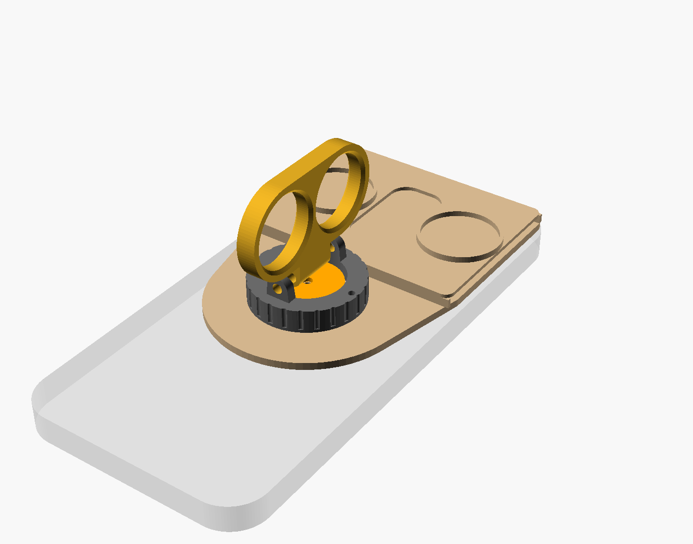
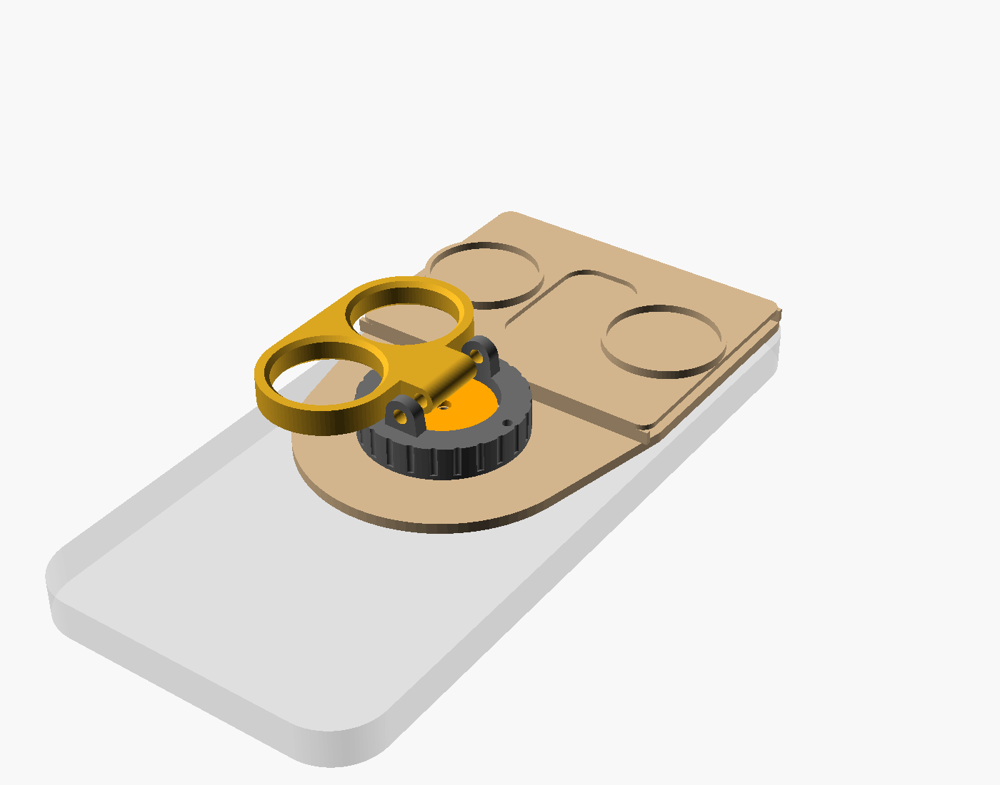

# Knuckle v1: passive roll-stabilizing MagSafe wallet grip

Made for the iPhone 18 Pro Max (163.4 × 78 × 8.75 mm, 249 g; check these against Apple's spec page).

## How it works
The phone, the plate and the cards spin together on a thin bearing around the axis that points out of the screen. The cards and coins hang below that axis like a pendulum, so the phone stays level while your wrist twists. The two-finger knuckle swings on a friction hinge: folded, it's a wallet; swung out, it's a grip.

- Pendulum period is about 1.2 s with 3 cards and 2 quarters. Slow wobble in your hand gets passed through, and quick shake is filtered out.
- It still balances if the phone's center of mass is up to about 8 mm above the MagSafe center. Add or remove quarters to trim it.
- It stabilizes **roll only** (horizon tilt). Pitch and pan follow your hand. A back-mounted pivot can't hold pitch passively, because the phone's weight sits in front of the pivot and would tip it face-down. Pitch is the axis to motorize in v2.
- It stabilizes in the orientation the cards hang. For landscape, attach the phone sideways on the magnet.

## Parts to buy
| Part | Qty |
|---|---|
| 6704ZZ bearing, 20 × 27 × 4 mm | 1 |
| MagSafe magnet ring, about 56 OD / 46 ID / 0.8 mm | 1 |
| M3 × 6 button-head screw | 1 |
| M3 × 20 bolt + nyloc nut | 1 |
| 2 mm steel pin, about 10 mm (or a cut paperclip) | 1 |
| US quarters (trim weight) | 0–4 |

## Printing
Files in `stl/` are already oriented flat-side-down. `print_all.stl` holds all four parts on one bed.
- PETG or PLA+, 0.2 mm layers, 4 walls, 40% gyroid infill.
- Plate: magnet face down. No supports.
- Carrier: bearing seat face down. The hinge lug holes may need light supports.
- Knuckle and cap: flat. No supports.

## Assembly
1. Glue the magnet ring into the recess on the plate's phone face, flush. Check its polarity against a MagSafe charger first so it attracts the phone.
2. Press the bearing into the carrier, then press the carrier and bearing onto the plate's shaft.
3. Drop the cap onto the bearing's inner race and screw it down with the M3 × 6.
4. Fit the knuckle between the lugs. Put the M3 × 20 bolt through and tighten the nyloc nut until the knuckle holds any angle you set.
5. Push the pin through the carrier's rim hole into the plate to lock the roll axis (useful when tapping the screen). Pull it out to free the axis.
6. Slide up to 3 cards in from the side. Press quarters into the round recesses to trim the balance.

## Tuning (top of `knuckle_v1.scad`)
- `finger_d`: measure your fingers at the middle joint and add 2 mm.
- `magsafe_y`: if the phone hangs tilted, the MagSafe ring isn't at the phone's center. Adjust this, or add coins.
- `cards`, `fit_shaft`, `fit_bore`: tune these for your printer's tolerances.

Export from the command line: `openscad -D 'PART="plate"' -o plate.stl knuckle_v1.scad`
